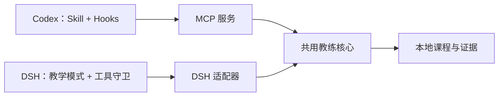

# 教教我 · Teach Me Dear

**在 Codex 和 DeepSeek Harness 中，用中文请 AI 带你亲手学会一个操作。**

直接说“教教我怎么使用 Godot”，教教我就会把目标拆成小步骤，给出操作提示，等你完成后，通过文件、命令结果或窗口截图核对实际结果，再继续下一步。

当前版本：**0.2.0 · 早期试用版**。主要面向 **Windows 本机使用**，采用 **MIT 许可**。

项目思路参考 [slimeball2026/DSH-Coach-mode](https://github.com/slimeball2026/DSH-Coach-mode)，窗口截图实现也改编自其中的代码。具体出处与许可见[参考与致谢](#参考与致谢)。

## 它能做什么

| 能力 | 使用体验 |
| --- | --- |
| 中文请教 | 说“教教我”“手把手教我做这个”，也可以显式调用 `$teach-me-dear`。 |
| 一次一个小目标 | 根据基础给出简洁要点或详细步骤，完成后再继续。 |
| 核查实际结果 | 用文件、JSON 字段、固定命令或窗口截图作为证据。 |
| 卡住时调整路线 | 获取提示、看小例子、拆小步骤或补充前置知识。 |
| 保存学习进度 | 支持暂停、恢复、回退、跳过和重排后续步骤。 |
| 跨客户端继续 | 在同一台电脑上，可以从 Codex 切换到 DSH，继续同一门课程。 |
| 区分完成方式 | 分别记录独立完成、帮助后完成、自评和跳过。 |

教学与截图判断使用宿主当前的模型，插件本身无需另行配置模型 API Key。截图判断需要模型具备看图能力。

### 0.2.0 的改进

- 每个新步骤都等待新的操作反馈，预查环境不算完成；已有文件符合条件也不会自动连续过关。
- 中文授权和自评支持自然表达，例如“可以，截吧”“这步我自己做完了”；简单“可以”只在明确的授权提问之后生效。
- 多个同名窗口先选再截，绑定具体窗口；软件重开后重新识别与授权。
- “别截图了”可以撤回授权。取证失败、无法判断和练习未通过分开记录，改计划时保留提示和示例记录。

## 快速开始

### 1. 准备环境

- **Node.js 24 或更高版本**，包含 npm。
- **Git**；使用下方 `gh repo clone` 命令时，还需要 **GitHub CLI**。
- 使用 Codex 时，需要支持本地插件和 Hooks 的 **Codex 客户端及 Codex CLI**。
- 使用 DSH 时，需要先启动过 **DeepSeek Harness**，使其生成 `desktop` 或 `web` profile。

当前安装流程主要面向 Windows。macOS、Linux 尚未完成实际验证，自动窗口截图仅支持 Windows。

### 2. 下载并安装依赖

```powershell
gh repo clone T-meow/teach-me-dear
cd teach-me-dear
npm ci
```

没有 GitHub CLI 时，也可以使用：

```powershell
git clone https://github.com/T-meow/teach-me-dear.git
cd teach-me-dear
npm ci
```

### 3. 安装到客户端

只安装到 Codex：

```powershell
node scripts/install.mjs --codex-only
```

只安装到 DSH：

```powershell
node scripts/install.mjs --dsh-only
```

两端一起安装：

```powershell
npm run install:local
```

安装器会生成适合当前电脑的 MCP 和 Hooks 配置，并添加客户端入口。这两份含本机路径的配置不进入 Git。请按上面的本地安装流程使用。

安装位置可自选；安装后保留项目目录。移动目录后，需要从新位置重新运行安装器。

### 4. 开始学习

**Codex：** 新开聊天，在插件列表启用“教教我 / teach-me-dear”。首次使用或更新后，如出现 **Review hooks**，先在界面中审阅并信任本插件的 Hooks。显式调用示例：

> 用 $teach-me-dear 教我怎么使用 Godot。我是初学者，想做一扇可以开关的门。

也可以直接说：

> 教教我怎么使用 Godot，一次一个小目标。

技能自动选择取决于宿主；需要明确指定本插件时，使用 `$teach-me-dear`。

**DSH：** 完全退出后重开，新建聊天时选择 **教教我**，然后输入相同的学习请求。

如果练习涉及现有项目，请提供实际工作目录。普通代办、直接修改代码或讨论插件开发，不应自动进入教学。

## 和它怎么说

| 你可以说 | 教教我会做什么 |
| --- | --- |
| “手把手教我做这个。” | 了解目标和基础，开始分步指导。 |
| “讲细一点。” / “只给我关键点。” | 调整讲解详细程度。 |
| “我做完了，帮我看看。” | 根据当前步骤的标准取证并核查。 |
| “给我一个提示。” | 提供帮助，并记录本步获得过提示。 |
| “这一步给我举个例子。” | 展示讲解示例，再由你完成练习。 |
| “这步太难了，拆小一点。” | 调整当前和后续计划，使旧证据失效。 |
| “今天先到这。” | 暂停并保留进度。 |
| “继续上次的练习。” | 查找并恢复已有课程。 |
| “回到上一步。” / “跳过这一步。” | 回退重做，或明确记录跳过。 |
| “退出教教我。” / “退出教学模式。” | 退出当前教学，保留课程。 |

DSH 的“教教我”模式专门用于教学；需要普通助手代办时，请切回普通模式。

## 结果如何核查

课程的每一步都绑定验收对象和标准，并等待该步开始后的新操作反馈。选窗、授权或简单应答不会自动完成练习。预查环境只提供起点信息，不能用来过关。证据属于具体步骤和本次尝试，调整计划或回退后需要重新取证。

| 方式 | 适用情况 | 判定方式 |
| --- | --- | --- |
| 文件存在 | 确认文件或目录已经创建 | 程序检查 |
| 文件包含原文 | 确认保存了指定内容 | 程序检查 |
| JSON 字段 | 确认结构化配置中的字段值 | 程序检查 |
| 固定命令 | 查看 Git 状态、确认工具版本等 | 程序检查 |
| 窗口截图 | 核对界面上可见的结果 | 当前模型结合画面判断 |
| 用户自评 | 当前无法直接取证的练习 | 用户明确自评，单独标记 |

程序判定的结果不能由模型覆盖。截图判断允许“无法确定”；失败的截图不能用来判通过。用户自评可以自然回复“这步我自己做完了”“完成了”或“自评通过”，结果仍会单独标记。疑问、否定和引用不会作为完成确认。

核查只证明所配置的具体条件。例如，文件存在不代表整个功能正确。教学时应选择能反映当前小目标的证据。

### 窗口截图

截图默认不授权。教练会先列出匹配的窗口标题；只有一个时自动绑定，多个时由你选择，例如“第二个”。列出窗口不会截取画面。

选定窗口后，教练会询问是否允许截图并把图片交给当前模型核查。你可以回复“可以”，也可以明确说“可以，截吧”。没有这次授权提问时，普通的“可以”不会被当作截图授权。选窗和授权可以合并回复，例如“第二个，可以截吧”。

- 同一条用户反馈最多截图 3 次，收到新的反馈后可以重试。
- 同一实际窗口获得授权后不重复询问；窗口关闭或软件重开后重新识别并授权，不会自动改截另一窗口。
- 说“别截图了”或“暂不截图”可以撤回授权。先说“做完了”、随后再授权时，无需重复声明完成。
- 将目标窗口恢复并切到前台，有助于避免最小化、遮挡或 GPU 渲染导致的截图失败。
- 持续抓不到时，可以调整计划，改用文件核查或用户自评。
- 画面会作为图片提供给当前宿主模型，截图文件也会保存在本机。

## 在 Codex 与 DSH 之间继续

两端读取同一份本地课程数据。切换客户端后，说“继续上次的练习”，由教练列出课程并选择继续。

同一门课程一次由一个聊天推进。另一个聊天接管后，旧聊天无法继续写入该课程，避免并行覆盖进度。已暂停的课程仍需先恢复。

这里的跨客户端指**同一台电脑**，目前不提供云同步。

## 数据存在哪里

Windows 默认目录：

```text
%APPDATA%\FrostForge\Coach\
├── coach-v1.sqlite       课程、进度、事件、最近的消息与操作反馈
└── shots/<课程ID>/      取证截图
```

SQLite 运行时可能产生 WAL/SHM 文件。数据格式目前为 v1，试用阶段不提供旧格式迁移。

可以通过 `FROSTFORGE_COACH_DATA` 指定其他数据目录。需要跨客户端继续时，两端应使用相同的设置。该目录名称和变量保留了项目最初的命名，不影响“教教我”的使用。

查看本机课程与数据位置：

```powershell
npm run status
```

插件不会在每次工具返回中重复附加历史图片，但宿主可能继续在聊天历史中保留它们。卸载插件不会删除课程和截图，可按需自行清理。

## 当前边界

- **演示是讲解示例。** 当前不会自动点击软件或替你修改练习工程。
- **Hooks 和工具守卫用于约束教学操作。** 它们受宿主的信任设置和工具覆盖范围影响，不能作为完整的系统隔离机制。
- **当前是早期试用版。** 两端插件接口变化可能影响兼容性，实际教学质量也取决于所用模型。
- **自动截图只支持 Windows。** 独占全屏、受保护内容和部分 GPU 窗口可能无法获取有效画面。

## 更新与卸载

更新源码后重新安装，需要时再审阅 Hooks：

```powershell
git pull
npm ci
npm run install:local
```

只使用一个客户端时，将最后一条换成对应的 `--codex-only` 或 `--dsh-only` 安装命令。

卸载 Codex 入口：

```powershell
codex plugin remove teach-me-dear@frostforge-local
```

卸载 DSH 入口：

```powershell
node scripts/uninstall-dsh.mjs
```

本地插件市场使用 `frostforge-local`。安装器会替换本项目的旧版 `frostforge-coach` 入口，并更新现有 DSH profile 中属于本插件的配置段落。

## 开发

```text
src/                       共用课程核心、数据存储、核查与截图
bin/                       MCP 服务、CLI、Codex Hooks
adapters/dsh/              DSH 模式与适配器
skills/teach-me-dear/       中文教学指引及技能元数据
scripts/                   本地安装、更新与卸载
test/                      核心流程与接入测试
.codex-plugin/             Codex 插件清单
.agents/plugins/           本地插件市场清单
```

Codex 通过 MCP 访问核心，DSH 通过本机 Node 进程调用相同的核心接口。课程独立存储，不依赖解析某个客户端的完整聊天日志。



运行测试：

```powershell
npm test
```

测试覆盖每步反馈门槛、预查不计入完成、证据绑定、过期写入、跨客户端接管、暂停回退、中文授权与撤回、多窗口选择、中文退出及安装配置替换。窗口逻辑使用模拟候选和证据；Windows 上还会解析生成的脚本，并执行一次不截图的窗口枚举检查。真实界面操作与模型教学效果仍需人工试用。

仅生成本机 MCP/Hooks 配置、不安装到客户端：

```powershell
node scripts/install.mjs --prepare-only
```

`CODEX_CLI` 可指定 Codex 可执行文件，`CODEX_HOME` 和 `DSH_HOME` 可指定客户端配置目录。当前 npm 包标记为 private，仓库采用 MIT 开源，暂不通过 npm 发布。

欢迎通过 Issues 反馈具体的软件版本、操作目标、复现步骤和错误信息；提交 PR 时，请说明行为变化及相关验证。请勿提交课程数据库、截图、凭据或安装器生成的本机配置。

## 参考与致谢

感谢 **slimeball2026** 的 [DSH-Coach-mode](https://github.com/slimeball2026/DSH-Coach-mode)。本项目的逐步教学、取证后推进和教学状态管理思路受到该项目启发。

此外，`src/capture.mjs` 的 Windows 窗口截图脚本改编自原项目 0.4.4 版本的 `captureScript` 和 `psLiteral`，保留了原作者版权及 MIT 许可。源码提交、对应文件和完整许可记录在 [THIRD_PARTY_NOTICES.md](./THIRD_PARTY_NOTICES.md)。

本项目在此基础上实现了 Codex/DSH 两端接入、独立课程存储、证据绑定、可调整计划和中文调用入口。

## 许可

本项目采用 [MIT License](./LICENSE)。直接改编的第三方代码声明见 [THIRD_PARTY_NOTICES.md](./THIRD_PARTY_NOTICES.md)。
